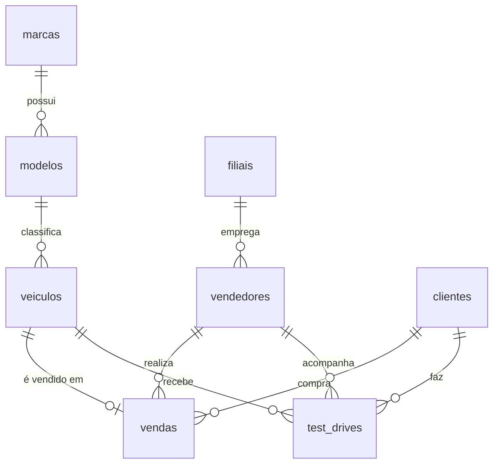

# 🚗 Concessionária de Veículos | Banco de Dados MySQL + Dashboard Power BI
 
Projeto de portfólio em análise de dados: da modelagem do banco de dados no **MySQL**, passando pelas consultas em **SQL**, até o dashboard no **Power BI** com medidas em **DAX**.
 
> ⚠️ Todos os dados são **fictícios**, gerados para fins de estudo (nomes, CPFs, e-mails e placas não correspondem a pessoas ou veículos reais).

## 🎯 Objetivo
 
Simular a operação de uma concessionária (estoque, vendas, vendedores, clientes e test drives) para praticar o ciclo completo de análise: **modelar → consultar → visualizar → extrair insights**.

## 🛠️ Tecnologias
 
| Etapa | Ferramenta |
|---|---|
| Banco de dados | MySQL 8 / MySQL Workbench |
| Consultas | SQL (`JOIN`, `GROUP BY`, `HAVING`, views, funções de data) |
| Visualização | Power BI Desktop |
| Cálculos | DAX |

## 🗂️ Modelo de dados
 

## 🔍 Perguntas de negócio respondidas com SQL
 
1. Quantos clientes moram em Campo Grande?
2. Quais veículos estão reservados ?
3. Quais marcas geram mais faturamento nas vendas, e como elas se comparam entre si ?
4. Quais são os 5 veículos mais acessíveis ?
5. Quais marcas tem maior influência em vendas ? 
6. Qual ticket médio dos anos 2024, 2025 e 2026 ? 

## 📊 Principais insights
 
| Indicador | Valor |
|---|---|
| Faturamento total | **R$ 2,72 milhões** |
| Veículos vendidos | **35** |
| Ticket médio | **R$ 77,79 mil** |
| Estoque disponível | **40 carros** (R$ 3,33 milhões) |
| Tempo médio para vender | **64 dias** |
| Conversão de test drive | **20%** (8 de 40) |

## 📬 Contato
 
Gostou do projeto ou tem sugestões? Fale comigo pelo LinkedIn.
